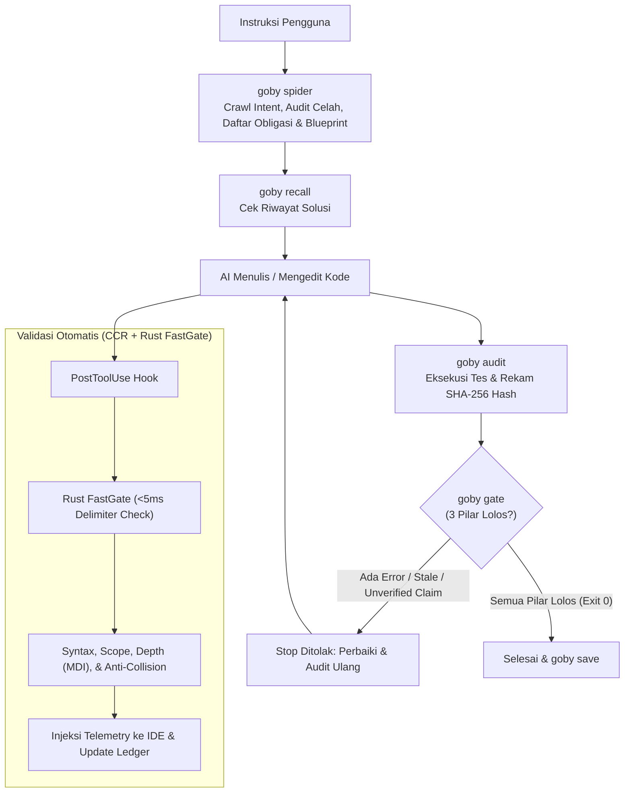

<div align="center">

# 🐟 Gobysh
### *Context Manager & Guardrail Framework untuk AI Coding Agent*

[](https://opensource.org/licenses/MIT)
[](https://python.org)
[](https://www.rust-lang.org)
[](#-pengujian)
[](#-perintah-cli)

<p align="center">
  Gobysh adalah kerangka kerja pengaman (guardrail) dan pengelola konteks untuk AI coding agent (Antigravity IDE, Claude Code, Cursor, dll). Memastikan AI memahami instruksi secara akurat, tidak membuat duplikasi fitur, menjaga kedalaman arsitektur kode, dan tidak berhenti sebelum semua verifikasi lolos.
</p>

</div>

---

## ⚡ Fitur Utama

- **Rust Native Acceleration Layer (`crates/goby_core`)**  
  Akselerasi hot-path menggunakan native binary Rust:
  - **Fast Gate (`goby fast-gate`)**: Validasi integritas pembatas (*delimiter/bracket balance*) dan struktur sintaks ultra-cepat (< 5 ms) untuk memangkas overhead hook IDE di Windows/Linux/macOS.
  - **Parallel AST & Symbol Indexer**: Pemindaian multi-threaded simbol kode, impor, kelas, dan fungsi untuk Python, JS/TS, Kotlin, dan Rust dengan *zero-drift fallback* otomatis ke implementasi Python jika binary belum dikompilasi.
- **Prompt Spider & Tripartite Semantic Bridge (`goby spider`)**  
  Merayapi instruksi pengguna, menandai elemen ke dalam 5 kategori empiris (`claim`, `owner`, `file`, `approval`, `vague`), memetakan semantik dwibahasa ID-EN ke AST kode nyata, dan menyusun 7-Pilar Empirical Blueprint (`ROLE`, `OBJEKTIF`, `CONTEXT`, `RULE`, `REVIEW`, `START`, `SHIP`).
  - **Taksonomi 5-Tag:** `claim` (klaim/hipotesis), `owner` (domain/layer), `file` (file riil di AST), `approval` (titik gate kritis), `vague` (deteksi kata abstrak yang memicu pertanyaan klarifikasi aktif).
  - **Mechanical Contract Binding:** Mengunci file proteksi dan aturan ke `cognitive_map.json` sehingga gerbang CCR `PostToolUse` langsung memblokir jika terjadi pelanggaran.
- **3D Technical Flaw & Anomaly Detector (`goby diagnose`)**  
  Mendeteksi potensi celah teknis pada 3 dimensi: kontradiksi prompt user, topologi proyek (tombol ganda / *capability collision*), dan logika/layout UI (teks tumpah keluar dari kotak berukuran tetap).
- **Architectural Depth Engine (`goby deepen`)**  
  Menganalisis rasio implementasi terhadap antarmuka (Module Depth Index / MDI berdasarkan prinsip Ousterhout). Modul pembungkus dangkal (*shallow pass-through wrapper*) otomatis diblokir via *Conditional Hard Gate*.
- **Anti-Collision & Visual Density**  
  Mendeteksi komponen agar kontrol tidak terduplikasi di tempat lain, serta mencegah pembungkusan tampilan secara berlebihan (*anti-boxification*).
- **3-Pillar Epistemic Exit Gate & Dynamic Audit (`goby gate`, `goby audit`, `goby obligation`)**  
  Mengadopsi prinsip verifikasi epistemik non-gimmick berbasis pembuktian empiris:
  - **Pilar 1 (Static Code Health)**: 0 unresolved CCR file error pada ledger aktif.
  - **Pilar 2 (Dynamic Test Freshness)**: Provenance bukti kriptografis berbasis SHA-256 workspace fingerprint. Bukti otomatis *STALE* dan memblokir penyelesaian jika file kode dimodifikasi setelah pengujian terakhir.
  - **Pilar 3 (Task Obligation Ledger)**: Klaim teknis dari Prompt Spider dicatat sebagai obligasi yang wajib dibuktikan lolos pengujian secara empiris (*fail-closed*).
- **Antigravity Mechanical Hard-Stop (`.agents/hooks.json`)**  
  Tersambung langsung ke IDE via lifecycle hooks. Memberikan telemetri MDI real-time pada setiap perubahan file, menginjeksi status gerbang pada `PreInvocation`, dan secara mekanis memblokir agent keluar (*Stop hook rejection*) jika salah satu dari 3 pilar epistemik belum terpenuhi.
- **Memory Lintas Sesi (`goby recall`, `goby save`)**  
  Menyimpan solusi yang berhasil agar sesi berikutnya dapat langsung melanjutkan tanpa mengulang eksplorasi dari awal.

---

## 🛠️ Alur Kerja



---

## 📊 Benchmark & Performa (Hot-Paths Acceleration)

| Pengujian / Operasi | Mesin Python Standar | Rust Native (`goby_core`) | Akselerasi / Keuntungan |
| :--- | :--- | :--- | :--- |
| **Fast Delimiter & Bracket Gate** | ~280 - 350 ms (interpreter startup) | **< 5 ms** (native execution) | **> 60x lebih cepat** |
| **Codebase AST & Symbol Scan** (`core/` 47 file) | ~390 - 450 ms (sekuensial `ast.parse`) | **~82 ms** (multi-threaded `rayon`) | **~5x lebih cepat** |
| **Memory Footprint** | ~35 MB (Python runtime) | **~4.2 MB** (standalone binary) | **Ringan & efisien** |
| **Paritas & Zero-Drift** | Baseline | 100% identik dengan fallback otomatis | Zero regressions |

---

## 🚀 Instalasi & Penggunaan

### Instalasi
```bash
git clone https://github.com/V4nds/Gobysh.git
cd Gobysh
pip install -e .

# (Opsional) Kompilasi Rust native accelerator untuk performa maksimal (<5ms)
cargo build --release --manifest-path crates/goby_core/Cargo.toml

goby install-hook
```

### Perintah CLI
```bash
# Cek status instalasi dan memori
goby status

# Rayapi prompt user, deteksi celah, dan susun 7-pilar blueprint
goby spider "buat tombol pengukuran sudut di canvas jangan ubah Toolbar.tsx" --save-plan

# Diagnosis potensi celah teknis (prompt, tombol dobel, atau teks tumpah)
goby diagnose "tambahkan fitur ke canvas tapi jangan ubah file canvas sama sekali"

# Cek integritas delimiter & struktur file secara ultra-cepat via Rust native gate
goby fast-gate core/cli.py

# Akses langsung sub-command native accelerator Rust (scan / check / version)
goby native version
goby native scan core/

# Cek kedalaman arsitektur kode (tambah --report untuk HTML visual)
goby deepen core/

# Validasi file kode sebelum commit
goby check core/ccr_engine.py

# Eksekusi audit verifikasi dinamis & rekam SHA-256 evidence provenance
goby audit

# Cek 3-Pilar Epistemic Exit Gate (Static Health, Freshness, Obligations)
goby gate

# Kelola dan tinjau status obligasi teknis
goby obligation list

# Cari solusi dari sesi sebelumnya
goby recall "pengukuran sudut"

# Simpan konteks sesi yang sudah selesai
goby save "Fitur pengukuran sudut selesai" create_feature src/canvas.js
```

---

## 📁 Struktur Proyek

```
Gobysh/
├── .agents/                    # Konfigurasi lifecycle hooks Antigravity (hooks.json)
├── crates/                     # Rust Native Accelerators
│   └── goby_core/              # Core crate: fast_gate, AST scanner, CLI binary (<5ms)
├── core/                       # Inti framework Python
│   ├── ccr_engine.py           # Cognitive Control Room & evaluator gate
│   ├── cli.py                  # Antarmuka CLI goby
│   ├── conversation_memory.py  # Penyimpanan & recall memori percakapan
│   ├── hooks.py                # Handler lifecycle hooks IDE
│   ├── intent_resolver.py      # Intent parsing & keyword heuristics
│   ├── spider/                 # Prompt Spider & Tripartite Semantic Bridge (v5.3)
│   │   ├── prompt_spider.py    # Mesin perayap prompt & 7-pilar synthesizer
│   │   └── semantic_bridge.py  # Jembatan dwibahasa ID-EN ke AST
│   ├── diagnostics/            # Technical Flaw & Anomaly Detector (v5.3)
│   │   └── flaw_detector.py    # Deteksi 3D: prompt, topologi (tombol dobel), layout
│   ├── taste_synthesis.py      # Evaluator visual density & layout
│   └── semantics/              # Analisis semantik & arsitektur
│       ├── depth_engine.py     # Analisis kedalaman AST & MDI
│       ├── capability_registry.py # Anti-collision kontrol
│       ├── specification.py    # Kontrak spesifikasi formal
│       └── constraints.py      # Deteksi kontradiksi
├── tests/                      # Rangkaian unit test (270 Python tests + 7 Rust tests)
├── AGENTS.md                   # Panduan operasional AI agent
├── pyproject.toml              # Konfigurasi package Python
└── README.md                   # Dokumentasi
```

---

## 🧪 Pengujian

Jalankan seluruh test suite bawaan:

```bash
# Python unit tests
python -m unittest discover tests/

# Rust native accelerator tests
cargo test --manifest-path crates/goby_core/Cargo.toml
```

- **Status**: 270/270 Python tests passed + 7/7 Rust tests passed (Total 277/277, 100% OK).

---

## 📜 Lisensi

[MIT License](LICENSE)
